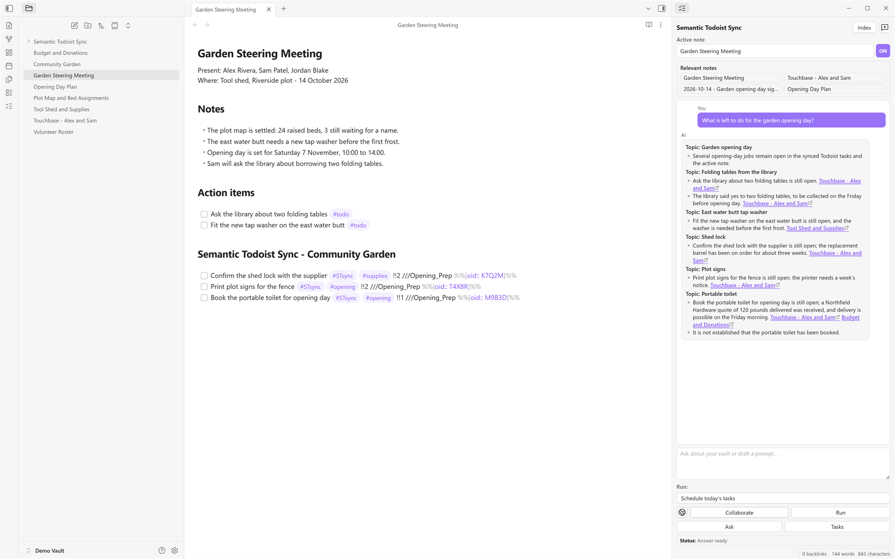
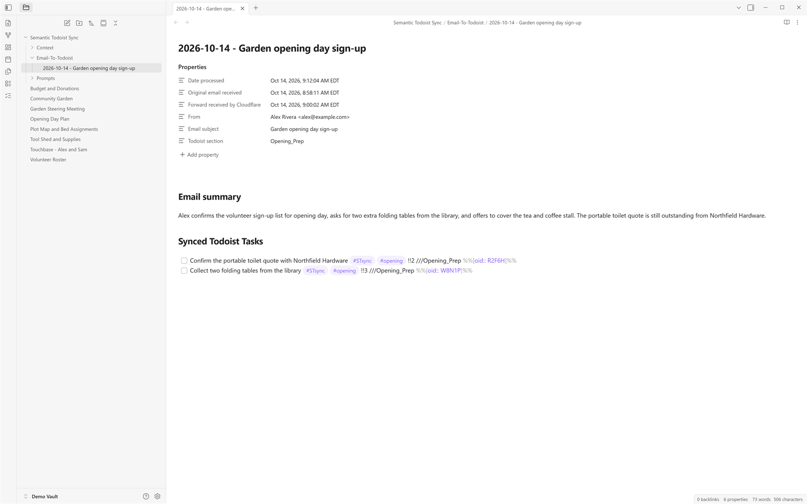

<p align="center">
  <strong>Semantic Todoist Sync</strong><br>
  Your Obsidian notes and your Todoist tasks, finally working together.<br><br>
  
</p>

*Semantic Todoist Sync running inside Obsidian: a meeting note with its synced task lines, and the sidebar answering a question from your vault.*

Ask about your notes, turn them into clear tasks, and plan today from what you already wrote.
See what's new in the [Changelog](CHANGELOG.md).

## Why you'll love it

| Feature | What it does for you |
| --- | --- |
| **Ask your notes** | Type a question and get an answer built from your vault, with a link back to every note it used. The search is semantic, so it finds the passage that means what you asked even when the words are different. |
| **Turn notes into tasks** | Mark an action in a note, or point the plugin at the note, a selection or a saved prompt, and you get main tasks and subtasks. Each description is written from your own notes and ends with a numbered list of the notes it came from. |
| **Email into Todoist** | Forward an email to your own queue and it becomes Todoist tasks. Signatures, legal disclaimers and quoted old replies are cleaned out before the plugin searches your vault, so the task is built from the actual request. |
| **Stay in sync without doubles** | Note lines and Todoist stay matched. The same task line twice links to the same Todoist task instead of creating a second one, and a possible match is flagged for you to check rather than merged quietly. |
| **Plan today in one pass** | "Schedule Today's Tasks" lays your open work across a workday and shows you the plan first. Drag the blocks around, tweak it, then apply it. |
| **Write with the vault in hand** | Turn on Collaborate and the sidebar drafts text straight into the open note from your notes, saved research and optional web search, with citations on what it used. Right-click a selection for rewrite presets, and nothing changes until you approve it. |
| **Internet Search and Deep Research** | Off by default. Turn them on for questions your notes cannot answer, and they run through your own provider's search service. |
| **Bring your own models** | OpenAI, Gemini, Anthropic, OpenRouter, a self-hosted Open WebUI with Ollama, or any OpenAI-compatible endpoint. You pick the model per job, and the plugin ships with none. |
| **The index repairs itself** | If an index file goes missing or is damaged, the plugin keeps the good parts, re-indexes only the notes that lost passages and tells you what it did, so vault search keeps working. |
| **It works on your phone** | The plugin is not desktop-only, so the sidebar, the settings and the day plan work on iPhone and iPad too. Background work such as email polling runs while Obsidian is open. |



Every processed email also leaves a log note in your vault. Its details sit in Obsidian's Properties panel, so you can always see who wrote it, what it was about and when it was handled.

## How tasks look in your note

You write the action. The plugin turns it into a task and leaves the finished line in your note.

```markdown
- [ ] Send the Q3 revenue report #todo
```

After a sync, the same work looks like this:

```markdown
- [ ] Send the Q3 revenue report #STsync !!1 ///Q3_Planning 📅 2026-10-30 %%[oid:: 8KD2Q]%%
    - [ ] Pull the revenue numbers from the finance sheet #STSubSync !!2 %%[oid:: 4XP1V]%%
```

- `#todo` is your marker for "this is an action". Change it in settings.
- `#STsync` marks a main task that syncs to Todoist, `#STSubSync` marks an indented subtask.
- `!!1` is the Todoist priority: `!!1` (highest) down to `!!4`.
- `///Q3_Planning` is the Todoist section the task lands in.
- `📅 2026-10-30` is the due date. `{{2026-10-30}}` is a deadline, the softer "by then".
- `%%[oid:: 8KD2Q]%%` is a hidden link. Obsidian does not show it; the plugin uses it to find the same task again.
- `%%[sched:: 2026-10-21T09:00; dur:: 45]%%` is the hidden time block that "Schedule Today's Tasks" adds: the start time and how long the task needs.
- The four spaces of indent are what make the second line a subtask of the first.

A task made from an email carries the email with it, so the description says where it came from:

```markdown
Ana asked for the Q3 revenue report before Friday (1).

**Email Source:**
From: Ana Ruiz <ana@example.com>
Subject: Q3 revenue report
Date: Oct 20, 2026, 9:14:00 AM EDT

**Context Notes:**
1. Meeting Notes/Q3 Planning.md
2. Finance/Revenue Sync.md
```

The `**Email Source:**` block is the email itself. `**Context Notes:**` is the numbered list of notes the task was built from, and the numbers match the `(1)` in the text above it.

The log note the email leaves behind starts with these properties, so Obsidian shows them in the Properties panel:

```markdown
---
Date processed: "Oct 20, 2026, 9:14:00 AM EDT"
Original email received: "Oct 20, 2026, 9:12:41 AM EDT"
Forward received by Cloudflare: "Oct 20, 2026, 9:13:02 AM EDT"
From: "Ana Ruiz <ana@example.com>"
Email subject: "Q3 revenue report"
Todoist section: "Email_26_10_20_Q3_revenue_report"
---
```

## Set up in minutes

1. Install from [Obsidian Community Plugins](https://obsidian.md/plugins?id=semantic-todoist-sync), or grab the
   [latest release](https://github.com/NeuroCloud-Activate/semantic-todoist-sync/releases/latest) for a manual install.
   Needs Obsidian 1.5.0 or later, on desktop, iPhone, and iPad.
2. Open `Settings > Semantic Todoist Sync`, add a provider under **AI Providers**, and press **Validate connection**.
3. Pick your models under **AI Models** and check the embedding choice.
4. Add your Todoist token, run the connection check, and rebuild the semantic index.
5. Optional, for email: add your Cloudflare Worker URL and token in settings, then send yourself a test email before turning on automatic processing.

## Everyday use

- Sidebar buttons **Ask**, **Tasks**, **Index**, and **Run** cover daily life.
  The command palette adds note sync, email runs, scheduling, and undo.
- Mark actions with `#todo` (changeable in settings). Main tasks get `#STsync`, subtasks get `#STSubSync`.
  Add `!!1`-`!!4` for priority, a calendar date for a due date, and `{{date}}` for a deadline.
- Each task gets a plain description drawn from your notes, with short source notes below.
  A source link that cannot be resolved is skipped quietly instead of failing the run.
- The relevant-notes panel lists what the last search or answer found, so you can open the note behind any claim.
- Markdown files in your prompt folder become reusable prompt actions, and the sidebar's action selector runs them.
- The status line at the bottom of the sidebar tells you what is happening right now, and what happened when it finished.
- Your label, priority, and date rules in settings guide the rest.

## Good to know

- Thinking models are handled for you. Reasoning defaults to **Automatic**, and any level you pick yourself always wins.
- Prompt caching for Claude models is on by default, so repeat requests across a note cost less.
- The deduplication toggle links repeats to the same Todoist task instead of creating doubles.
- Search mode defaults to Exact, and Routed is an opt-in speed setting for very large vaults.
  Custom OpenAI-compatible endpoints support chat and embeddings, but not web search.

<details>
<summary>Privacy and network</summary>

- The plugin is free, takes no payments or donations, has no account of its own, and is open source under the GNU General Public License v3.0.
- You need a Todoist account and token for Todoist jobs, and a provider account for paid providers. Self-hosted options can run without one.
- Todoist jobs reach only `api.todoist.com`. AI jobs reach only the provider you picked.
  Internet Search and Deep Research use your provider's search service. Email jobs reach only the Worker address you enter.
  The optional System One decision model reaches only the server address you type (task text and short note excerpts go there; leave it off to send nothing).
  Debug logging talks only to the collector on your own computer. Each call sends only what that job needs.
- Your index, task links, and scheduling memory stay on your device. Todoist receives task fields only when you run Todoist jobs.
- No telemetry is sent to us, there are no ads, and the plugin never installs or updates itself.

</details>

## Links

- [Changelog](CHANGELOG.md) and [License](LICENSE), GNU General Public License v3.0.
- We compared models on a real, messy meeting note. See the [benchmark protocol](docs/model-quality-benchmark.md)
  and the [earlier scorecard](docs/model-quality-benchmark-scorecard-2026-08-09.json) for results.

## Tips

> [!TIP]
> **Forward anything.** Any email works, including one with attachments or images. The plugin reads the request itself and leaves the signature, the legal footer and the quoted replies out of it.

> [!NOTE]
> **Nothing you schedule is permanent.** "Schedule Today's Tasks" is only a preview. Nothing reaches Todoist until you press **Apply**, and "Undo last schedule today apply" puts it back.

> [!TIP]
> **Pause and resume email.** If an email stops on a failure it waits instead of retrying forever. Press **Resume** in the Email Tasks settings tab and it carries on.
